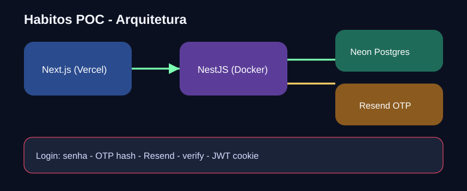

# Hábitos — POC Lab

**Versão:** `0.3.1`

Aplicação de hábitos diários usada como **laboratório de engenharia com agentes de IA** (Cursor). O objetivo não é só “um CRUD online”: é deixar auditável *como* humano e agente colaboraram, quais decisões foram tomadas e por que certas medidas de arquitetura/segurança valem a pena.

**Stack:** Next.js · NestJS · Prisma · Neon · Resend · Web Push · Cloudflare Turnstile · Docker · Vercel  
**Repo:** [AlaminoCS/poc-app](https://github.com/AlaminoCS/poc-app) · **Web:** [poc.alamino.dev.br](https://poc.alamino.dev.br)

## Novidades 0.3.1

- Chrome único: logo **Hábitos** + menu hambúrguer em todas as páginas
- Logo/Home leva a `/app` quando logado (não mais à landing deslogada)
- Rodapé alinhado ao site pessoal (crédito Alamino Code Solutions → [alamino.dev.br](https://alamino.dev.br/)) + versão
- Contrate-me: links públicos modernizados; formulário de mensagem pré-preenchido com nome/e-mail da sessão

## Novidades 0.3.0

- UX: hábitos em evidência; menu hambúrguer; lembretes em `/app/lembretes`
- Editar hábito faz scroll até o formulário; ações do card em menu “⋯”
- **Manter conectado** (sessão 30d pós-OTP; OTP continua obrigatório a cada login)
- Feedback háptico no mobile no check-in
- Diagrama SVG corrigido para Preview no GitHub + README com “porquê” da stack

## Novidades 0.2.0

- Perfil com nome e `birthDate` (idade mínima 13 — LGPD); banner **Feliz aniversário**
- Troca de senha logada com confirmação **OTP**
- Edição de hábitos; frequência; horário de lembrete; calendário; Web Push; Turnstile; LGPD

## Para quem analisa este repositório

1. Este `README.md` — visão rápida, versão e como rodar  
2. [`CONTEXT.md`](CONTEXT.md) — produto, stack e restrições  
3. [`AGENTS.md`](AGENTS.md) — contrato operacional do agente  
4. [`docs/LAB.md`](docs/LAB.md) — diário e trade-offs  
5. [`docs/SECURITY.md`](docs/SECURITY.md) — pepper, OTP, push, Turnstile, LGPD  
6. Diagramas em `docs/` · histórico git semântico  

## Como trabalhamos (humano + agente)

O humano define intenção, restrições e critérios de pronto. O agente executa implementação, scaffolding, docs e smoke checks dentro desse contrato. Nada crítico fica só no chat: decisões viram arquivos versionados. Entregas grandes seguem **E2E da fatia → push → smoke em produção**.

## O que a POC demonstra

- Cadastro/login com e-mail e senha + OTP via Resend  
- “Manter conectado” (TTL longo) sem pular OTP  
- Perfil, reset/change-password com OTP  
- Hábitos com frequência, horário, edição, check-in e streak  
- Calendário de cumprimento e lembretes Web Push  
- Contrate-me protegido + LGPD  

## Por que esta stack

| Tecnologia | Por quê |
|------------|---------|
| **Next.js** | UI App Router, deploy simples na Vercel, rotas finas e componentes client onde a POC precisa de interação |
| **NestJS** | API modular com DI (Controller → Service → Repository), alinhada ao contrato em `AGENTS.md` |
| **Prisma + migrations** | Schema versionado e `migrate deploy` previsível (sem `db push` em produção) |
| **Neon Postgres** | Postgres gerenciado compatível com Vercel; `DATABASE_URL` + `DIRECT_URL` para migrate |
| **Argon2id + pepper** | Hash moderno; pepper em env adiciona camada se o banco vazar |
| **JWT em cookie HttpOnly** | Sessão sem expor token ao JS; `SameSite=Lax` + `Secure` em prod |
| **Resend** | OTP e e-mails de contato sem SMTP próprio; domínio verificado para sair do sandbox |
| **Web Push + VAPID** | Lembretes com app fechado, padrão web sem app nativo |
| **Cloudflare Turnstile** | Anti-bot gratuito no contato, sem CAPTCHA clássico |
| **Docker (API)** | Nest em container no Vercel Services — cookies/sessão previsíveis fora de serverless |
| **Vercel Services** | Web + API no mesmo projeto com rewrite `/api` same-origin |
| **Playwright** | E2E do fluxo real (cadastro → OTP → hábitos) antes de cada push relevante |
| **pnpm + Turborepo** | Monorepo com packages compartilhados (`db`, `shared`) e builds filtrados |

## Arquitetura



Fonte editável: [`docs/architecture.excalidraw`](docs/architecture.excalidraw).

```text
Quem analisa o repo → Next.js + Nest (Vercel Services) → Neon Postgres
                         ↓                    ↓
                      Web Push cron        Resend OTP / contato
                         ↓
                   Cloudflare Turnstile
```

## Subir local

```bash
cp .env.example .env
# preencha secrets (Resend, pepper, JWT, VAPID, Turnstile, CONTACT_HMAC_SECRET, CRON_SECRET)

pnpm install
pnpm db:generate
pnpm db:migrate
pnpm dev
```

- Web: http://localhost:3000  
- API: http://localhost:3001/api/health  
- E2E: `pnpm test:e2e`

## Variáveis de ambiente

Ver [`.env.example`](.env.example).

| Variável | Papel |
|----------|--------|
| `DATABASE_URL` / `DIRECT_URL` | Neon / Postgres |
| `PASSWORD_PEPPER` / `JWT_SECRET` | Auth |
| `JWT_EXPIRES_IN` / `JWT_EXPIRES_IN_REMEMBER` | Sessão normal (1d) vs manter conectado (30d) |
| `RESEND_API_KEY` / `RESEND_FROM` | OTP e contato |
| `VAPID_*` / `NEXT_PUBLIC_VAPID_PUBLIC_KEY` | Web Push |
| `CRON_SECRET` | Protege `/api/internal/reminders/tick` |
| `TURNSTILE_*` / `NEXT_PUBLIC_TURNSTILE_SITE_KEY` | Anti-bot |
| `CONTACT_HMAC_SECRET` | Unlock token de contato |
| `NEXT_PUBLIC_APP_URL` | URL pública |

## Deploy

Monorepo na Vercel com **Services** (`vercel.json`: web Next + API container). Lembretes: cron diário no Hobby + endpoint tick com `CRON_SECRET` (scheduler externo a cada 5 min se necessário). Domínio: [poc.alamino.dev.br](https://poc.alamino.dev.br).
